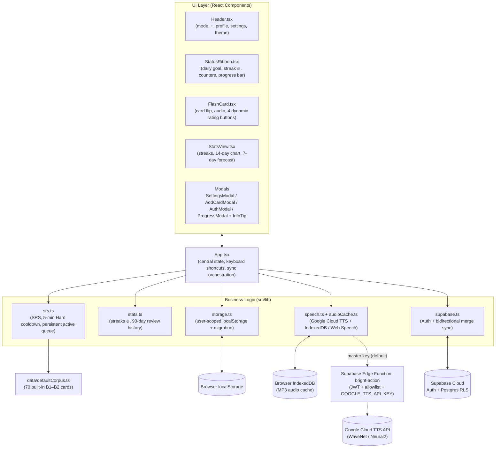
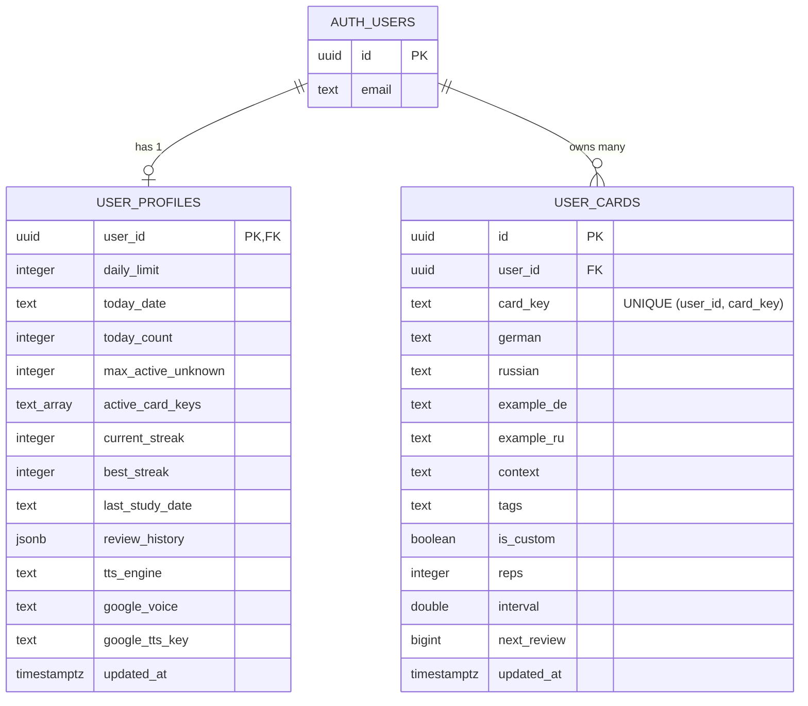
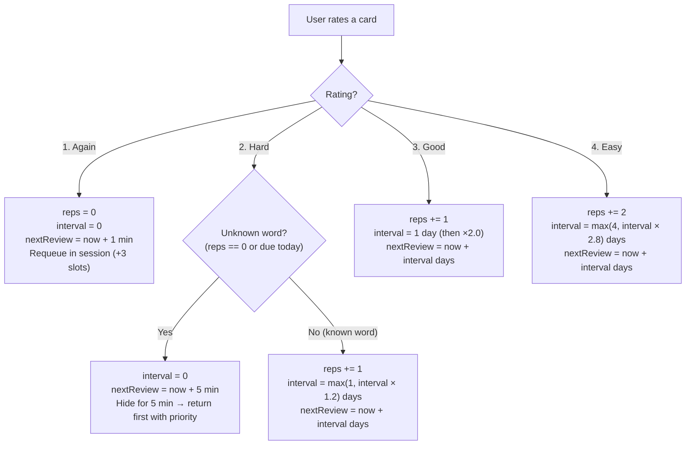
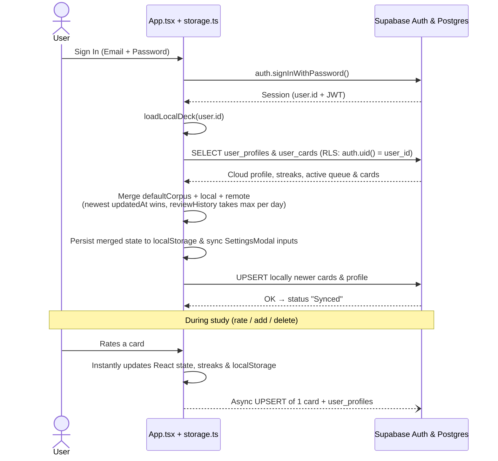
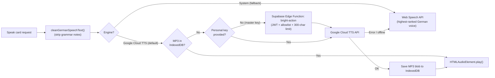

# Architecture & Code Walkthrough — Deutsch B1–B2 Anki Mobile

This document describes the application architecture, spaced repetition (SRS) algorithm, Supabase cloud synchronization, speech synthesis pipeline, and key modules.

---

## 1. High-Level Architecture

The app is built as a **Local-First SPA** using **React 19 + TypeScript + Vite + Tailwind CSS v4**:
- Every user action (flipping a card, rating, adding/deleting a card, updating limits) is persisted immediately to `localStorage` for instant, zero-latency UX and offline support.
- Once signed in via **Supabase Auth**, per-card progress, custom cards, streaks, review history, and study preferences synchronize asynchronously with PostgreSQL protected by **Row Level Security (RLS)**.



---

## 2. Project Structure

```text
anki/
├── index.html                      # Minimal Vite HTML entry point
├── package.json                    # Dependencies (React 19, Supabase, Vite, Tailwind v4)
├── tsconfig.json                   # Strict TypeScript config (strict: true)
├── vite.config.ts                  # Vite + React + Tailwind CSS v4 config (base: './')
├── supabase_schema.sql             # PostgreSQL tables, RLS policies, and safe migrations
├── supabase/
│   └── functions/
│       └── tts/
│           └── index.ts            # Edge Function: Google Cloud TTS proxy with master key
├── .github/workflows/deploy.yml    # Automated Node 24 build & GitHub Pages deployment
└── src/
    ├── main.tsx                    # React root mount
    ├── index.css                   # Tailwind v4 import and mobile safe-area styles
    ├── types.ts                    # Shared TypeScript interfaces and types
    ├── App.tsx                     # Root state container, effects, and hotkeys
    ├── data/
    │   └── defaultCorpus.ts        # 70 built-in cards (50 vocabulary + 20 grammar)
    ├── lib/
    │   ├── srs.ts                  # Spaced repetition, 5-min Hard delay, active queue
    │   ├── stats.ts                # Streak tracking (🔥), 90-day review history & merge
    │   ├── storage.ts              # User-scoped localStorage persistence
    │   ├── audioCache.ts           # IndexedDB MP3 blob cache for Google Cloud TTS
    │   ├── speech.ts               # Speech engine: Google Cloud TTS + Web Speech fallback
    │   └── supabase.ts             # Supabase client and fullSync / upsert / delete logic
    └── components/
        ├── Header.tsx              # Top bar: mode, +, auth status, settings, theme
        ├── StatusRibbon.tsx        # Daily goal, clickable streak 🔥, counters, progress bar
        ├── FlashCard.tsx           # Interactive card with dynamic rating interval labels
        ├── StatsView.tsx           # Statistics page: streaks, 14-day chart, 7-day forecast
        ├── SettingsModal.tsx       # Voice, limits (synced with profile), custom cards, CSV
        ├── AddCardModal.tsx        # Form to create a new custom card
        ├── AuthModal.tsx           # Sign in / sign up / manual sync / sign out
        ├── ProgressModal.tsx       # Card-by-card progress list, filters, search, reset
        └── InfoTip.tsx             # Tap/click "?" in-app help popover component
```

---

## 3. Data Model & Supabase Schema

### Card Model (`src/types.ts`)

Both built-in and user-created cards share the same `Card` interface:

| Field | Type | Description |
| :--- | :--- | :--- |
| `cardKey` | `string` | Unique key: `default_1`…`default_70` for built-in cards, `custom_<uuid>` for user cards |
| `german`, `russian` | `string` | German term/structure and Russian translation |
| `example_de`, `example_ru` | `string` | Contextual example sentence and translation |
| `context`, `tags` | `string` | Grammar note (e.g. `Verb (+ Dat.)`) and tags |
| `isCustom` | `boolean` | Distinguishes user-created cards from built-in cards |
| `reps` | `number` | Successful repetitions: `0` = New, `1–2` = Learning, `≥ 3` = Mastered |
| `interval` | `number` | Current review interval in days |
| `nextReview` | `number` | Unix timestamp (ms) for the next scheduled review |
| `updatedAt` | `number` | Unix timestamp (ms) of last modification (used for cloud conflict resolution) |

### PostgreSQL Schema (`supabase_schema.sql`)



> **Why aren't all 70 built-in cards inserted into `user_cards` on first login?**
> The base corpus ships inside `defaultCorpus.ts`. Only cards with progress (`reps > 0` or `updatedAt > 0`) or custom cards (`is_custom = true`) are written to Supabase. On any new device, the client merges `defaultCorpus.ts` with rows from `user_cards`.

---

## 4. Spaced Repetition (SRS) & Active Queue

All scheduling logic lives as pure functions in `src/lib/srs.ts`.

### Definition of an "Unknown Word" (`isUnknownCard`)
A card is considered **unknown** if:
1. `card.reps === 0` (never learned or reset via "Again"), OR
2. `card.nextReview <= endOfToday` (still scheduled for review today, not yet promoted to tomorrow+).

### Rating Rules (`applyCardRating`)



Button interval previews (`1 мин`, `5 мин` / `1 дн.`, `4 дн.`) are computed dynamically per card via `getRatingPreviewLabels(card)`.

### Persistent Active Queue & Both-Sides Mastery (`reconcileActiveQueue` + `expandCardsToQueueItems`)
1. `user_profiles` (and `localStorage`) stores `max_active_unknown` (default **`5`**) and the exact **`active_card_keys`** array so the same active words survive page reloads and sync across devices.
2. Only **hard/due-now** cards (`nextReview <= now`, prioritized first) and **new** cards (`reps === 0`) occupy the active queue; cards on a 5-minute "Hard" cooldown are temporarily hidden until their timer expires, then immediately return to the front of the queue.
3. In **Mixed** mode, `expandCardsToQueueItems` expands `5` active words into **`10` queue items** (`DE → RU` and `RU → DE`), interleaved so the two sides of a word do not appear back-to-back.
4. **Two-sided promotion**: `App.tsx` tracks completed sides in `passedSidesRef`. A card only advances its SRS level (`reps` / `nextReview`) and gets replaced by the next word in `active_card_keys` once **both** sides have passed.

---

## 5. Authentication & Sync Flow (`src/lib/supabase.ts`)



---

## 6. Speech Engine & Edge Function (`src/lib/speech.ts`, `src/lib/audioCache.ts`, `supabase/functions/tts/index.ts`)



- **Server-side master key (`supabase/functions/tts/index.ts`, deployed slug `bright-action`)**: reads `GOOGLE_TTS_API_KEY` from **Supabase Secrets** (never exposed to the browser), verifies the user's JWT (`auth.getUser()`), enforces a strict free-tier allowlist (`de-DE-Wavenet-B/C`, `de-DE-Neural2-B/C/D/F`, default `de-DE-Wavenet-C`), and caps text length at `300` characters.
- **IndexedDB MP3 cache (`audioCache.ts`)**: caches generated MP3 blobs locally under `voice|rate|pitch|text` so repeated card reviews cost zero API quota and work offline.
- **Automatic fallback**: if unauthenticated (without a personal key), offline, or on API error, playback seamlessly falls back to `Web Speech API`.

---

## 7. Streaks, Statistics & Deployment

- **Streaks & History (`src/lib/stats.ts` + `src/components/StatsView.tsx`)**: tracks `currentStreak`, `bestStreak`, `lastStudyDate`, and a rolling 90-day `reviewHistory` map (`YYYY-MM-DD → count`). `StatsView` renders a 14-day activity bar chart, deck mastery breakdown, and a 7-day upcoming review forecast.
- **In-App Help (`src/components/InfoTip.tsx`)**: tap/click `?` popovers inside `SettingsModal` explain each setting on both mobile and desktop.
- **Build & Deploy**: `vite.config.ts` sets `base: './'`, and `.github/workflows/deploy.yml` runs `npm ci && npm run build` on Node 24 to publish `dist/` to GitHub Pages on every push to `main`.
