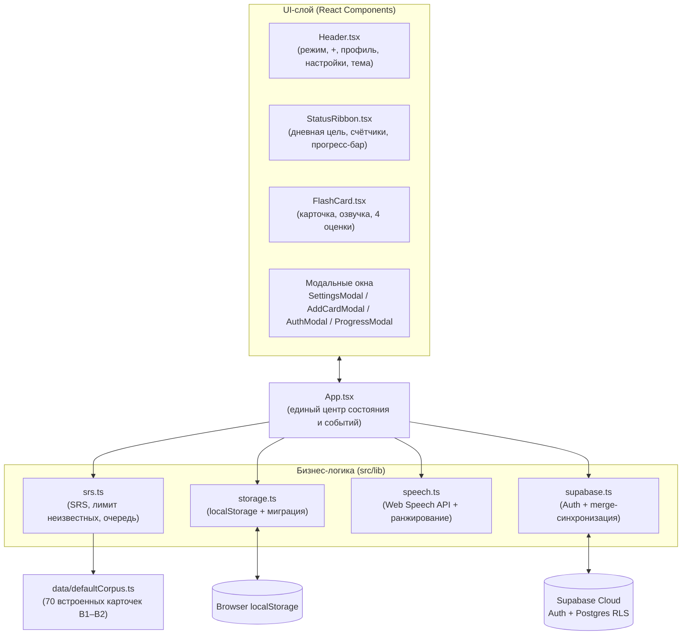
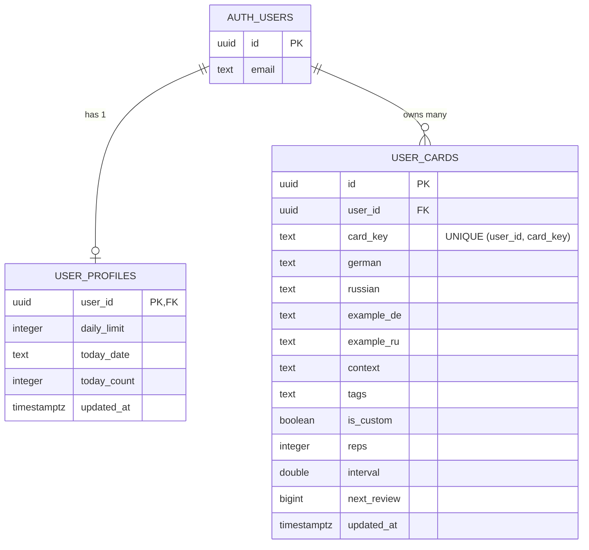
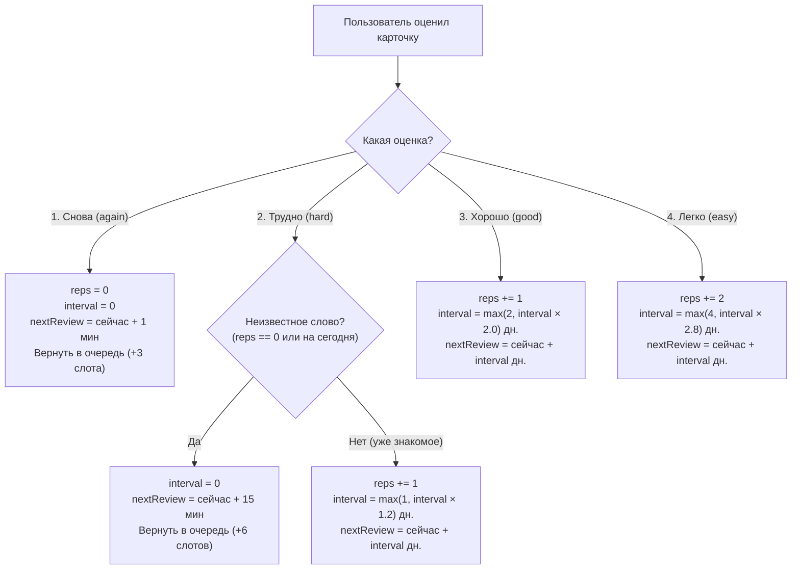
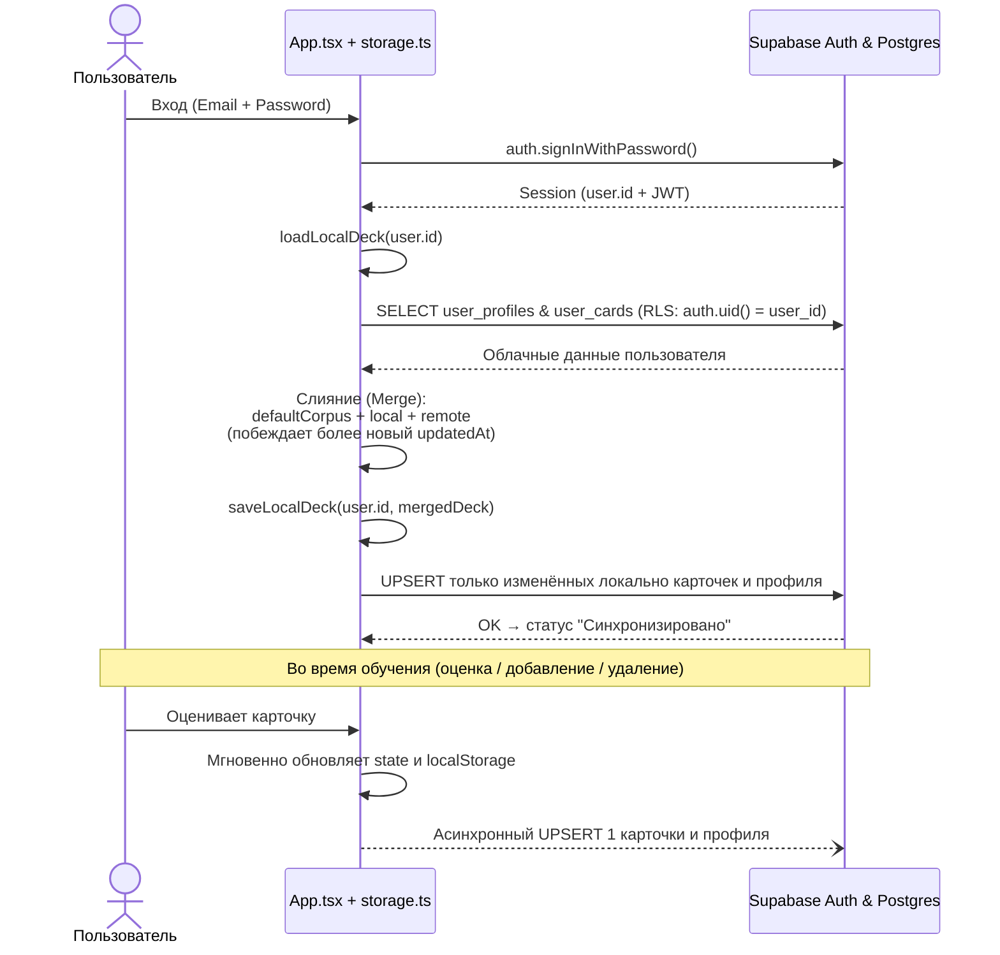

# Архитектура и разбор кода — Deutsch B1–B2 Anki Mobile

Этот документ описывает структуру приложения, алгоритмы интервального повторения (SRS), схему синхронизации с Supabase и устройство ключевых модулей.

---

## 1. Общая архитектура

Приложение построено по принципу **Local-First SPA** (React 19 + TypeScript + Vite + Tailwind CSS v4):
- Все действия пользователя (переворот, оценка карточки, добавление слова) мгновенно сохраняются в `localStorage` — интерфейс работает без задержек и доступен офлайн.
- При входе в аккаунт **Supabase** включается асинхронная двусторонняя синхронизация прогресса и пользовательских карточек с защитой **Row Level Security (RLS)**.



---

## 2. Структура файлов проекта

```text
anki/
├── index.html                      # Минимальная HTML-точка входа для Vite
├── package.json                    # Зависимости (React, Supabase, Vite, Tailwind)
├── tsconfig.json                   # Строгие настройки TypeScript (strict: true)
├── vite.config.ts                  # Конфигурация сборки Vite + Tailwind CSS v4
├── supabase_schema.sql             # SQL-схема таблиц и политик RLS в Supabase
├── .github/workflows/deploy.yml    # Автоматический билд и деплой на GitHub Pages
└── src/
    ├── main.tsx                    # Монтирование React в #root
    ├── index.css                   # Подключение Tailwind v4 и мобильные safe-area стили
    ├── types.ts                    # Все TypeScript-интерфейсы и типы
    ├── App.tsx                     # Главный контейнер состояния, эффектов и горячих клавиш
    ├── data/
    │   └── defaultCorpus.ts        # 70 встроенных карточек (50 слов + 20 грамматики)
    ├── lib/
    │   ├── srs.ts                  # Алгоритм повторений, лимит неизвестных слов, очередь
    │   ├── storage.ts              # Сохранение/загрузка localStorage с разделением по userId
    │   ├── speech.ts               # Озвучка немецких слов и очистка грамматических меток
    │   └── supabase.ts             # Клиент Supabase и логика fullSync / upsert / delete
    └── components/
        ├── Header.tsx              # Шапка: режим, +, статус входа, настройки, тема
        ├── StatusRibbon.tsx        # Кликабельная строка статистики и прогресс-бар сессии
        ├── FlashCard.tsx           # Карточка с переворотом и динамическими кнопками оценки
        ├── SettingsModal.tsx       # Голос, лимиты, «Мои карточки», CSV импорт/экспорт
        ├── AddCardModal.tsx        # Форма создания пользовательской карточки
        ├── AuthModal.tsx           # Вход / регистрация / ручная синхронизация / выход
        └── ProgressModal.tsx       # Детальный прогресс, фильтры, поиск, сброс карточки
```

---

## 3. Модель данных и база Supabase

### Структура карточки (`src/types.ts`)

Каждая карточка (как встроенная, так и добавленная пользователем) приводится к единому формату `Card`:

| Поле | Тип | Назначение |
| :--- | :--- | :--- |
| `cardKey` | `string` | Уникальный ключ: `default_1`…`default_70` для встроенных, `custom_<uuid>` для пользовательских |
| `german`, `russian` | `string` | Основное слово/конструкция и перевод |
| `example_de`, `example_ru` | `string` | Контекстный пример и его перевод |
| `context`, `tags` | `string` | Грамматическая пометка (`Verb (+ Dat.)`) и теги |
| `isCustom` | `boolean` | Отличает пользовательскую карточку от базовой (влияет на возможность удаления и фильтр «Мои») |
| `reps` | `number` | Количество успешных повторений: `0` — Новая, `1–2` — Учим, `≥ 3` — Выучена |
| `interval` | `number` | Текущий интервал повторения в днях |
| `nextReview` | `number` | Unix-timestamp (мс), когда карточку нужно показать снова |
| `updatedAt` | `number` | Unix-timestamp (мс) последнего изменения — используется при слиянии конфликтов с облаком |

### Схема таблиц в PostgreSQL (`supabase_schema.sql`)



> **Почему в `user_cards` не загружаются сразу все 70 базовых карточек?**
> Базовый словарь вшит в `defaultCorpus.ts`. В БД записываются только те карточки, по которым есть прогресс (`reps > 0` / `updatedAt > 0`) или которые создал сам пользователь (`is_custom = true`). Это экономит запросы и трафик, а при синхронизации на новом устройстве базовые карточки автоматически объединяются с записями из БД.

---

## 4. Алгоритм интервального повторения (SRS) и лимит неизвестных слов

Вся математика вынесена в чистые функции в `src/lib/srs.ts` (их легко тестировать отдельно от UI).

### Что такое «неизвестное слово» (`isUnknownCard`)
Слово считается **неизвестным**, если выполняется хотя бы одно условие:
1. `card.reps === 0` — вы его ещё не учили (новая карточка или нажали «Снова»).
2. `card.nextReview <= endOfToday` — карточка всё ещё запланирована к повторению **сегодня** (не «ушла» на завтра и далее).

### Логика 4 кнопок оценки (`applyCardRating`)



Подписи времени на самих кнопках (`1 мин`, `15 мин` / `2 дн.`, `4 дн.`) рассчитываются динамически функцией `getRatingPreviewLabels(card)` для каждой конкретной карточки.

### Формирование очереди и лимит неизвестных (`buildSessionQueue`)

Чтобы при дневном лимите в 60–160 показов не вываливалось сразу 60 новых слов:
1. Карточки делятся на три группы:
   - `dueToday` — уже начатые карточки, которые нужно повторить сегодня (`reps > 0 && nextReview <= endOfToday`).
   - `newCards` — новые карточки (`reps === 0`).
   - `futureCards` — карточки, запланированные на завтра и позже.
2. Применяется настраиваемый лимит `maxActiveUnknown` (по умолчанию `10`):
   - Сначала берутся `dueToday` (до `maxActiveUnknown`).
   - Оставшиеся слоты (`maxActiveUnknown - activeDue.length`) заполняются из `newCards`.
   - Итоговый пул ограничивается оставшимся дневным лимитом показов (`dailyLimit - dailyReviewedCount`).

---

## 5. Поток авторизации и синхронизации с Supabase

Реализовано в `src/lib/supabase.ts` и вызывается из `src/App.tsx`:



### Изоляция локальных данных (`src/lib/storage.ts`)
- В гостевом режиме используется префикс `anki_guest_*` (с автоматическим подхватом старых ключей `anki_de_corpus_v3`).
- После входа используется префикс `anki_u_<userId>_*`. При выходе из аккаунта локальные данные разных пользователей не смешиваются.

---

## 6. Разбор остальных модулей

### Движок озвучки (`src/lib/speech.ts`)
- **`rankVoice`**: присваивает веса голосам браузера (`natural/neural` → 100, `Google Deutsch` → 80, `Anna/Katja/Petra/Markus` → 70, `enhanced/premium` → 60, любой `de-DE` → 50) и автоматически выбирает лучший доступный.
- **`cleanGermanSpeechText`**: перед озвучкой вырезает служебные грамматические пометки в скобках (`(Verb am Ende)`, `+ Dat.`, `Grammatik:`), чтобы диктор читал только естественную немецкую фразу.

### Главный контейнер (`src/App.tsx`)
- Хранит состояние колоды (`deck`), текущей очереди (`queue`, `currentIndex`, `isFlipped`), дневной статистики (`stats`), настроек озвучки (`speechSettings`) и открытых модальных окон.
- Обрабатывает глобальные горячие клавиши (`Space` — показать ответ, `1`–`4` — оценки, `Esc` — закрыть любое окно), автоматически отключая их, когда открыто модальное окно или фокус находится в поле ввода.

### Сборка и автодеплой
- `vite.config.ts` задаёт `base: './'`, благодаря чему собранные бандлы корректно открываются по любому пути (включая `https://<user>.github.io/anki/`).
- `.github/workflows/deploy.yml` при каждом `git push` в ветку `main` автоматически запускает `npm ci && npm run build` (`tsc -b && vite build`) и публикует папку `dist/` на GitHub Pages.
